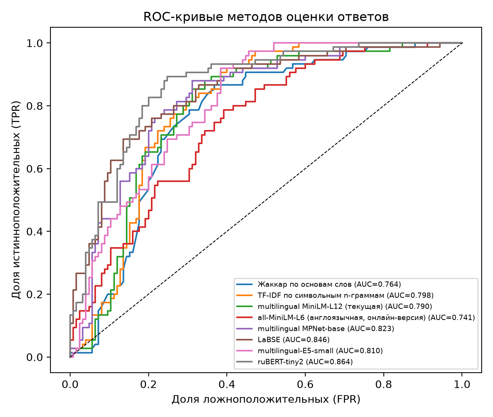
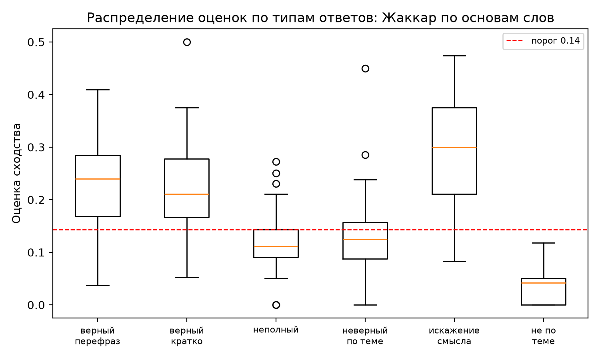
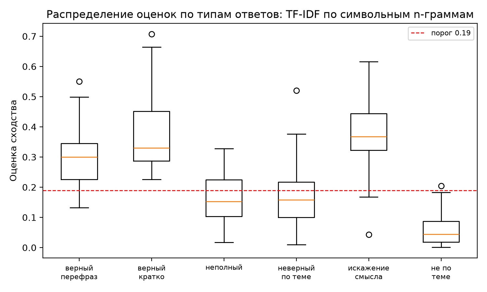
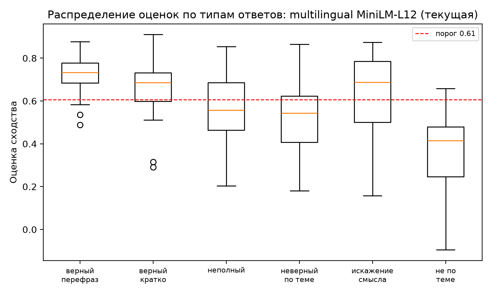
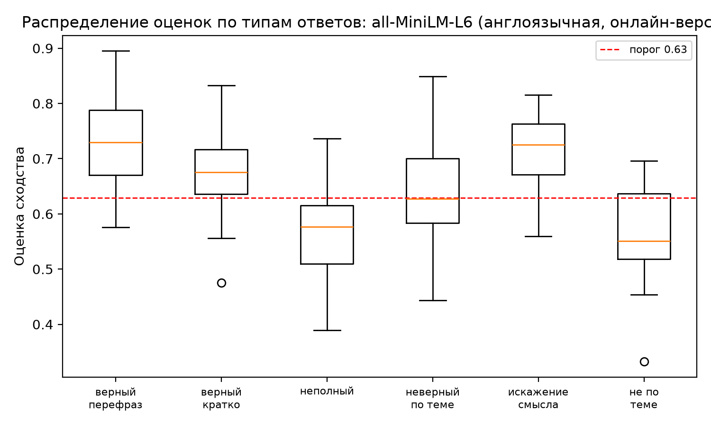
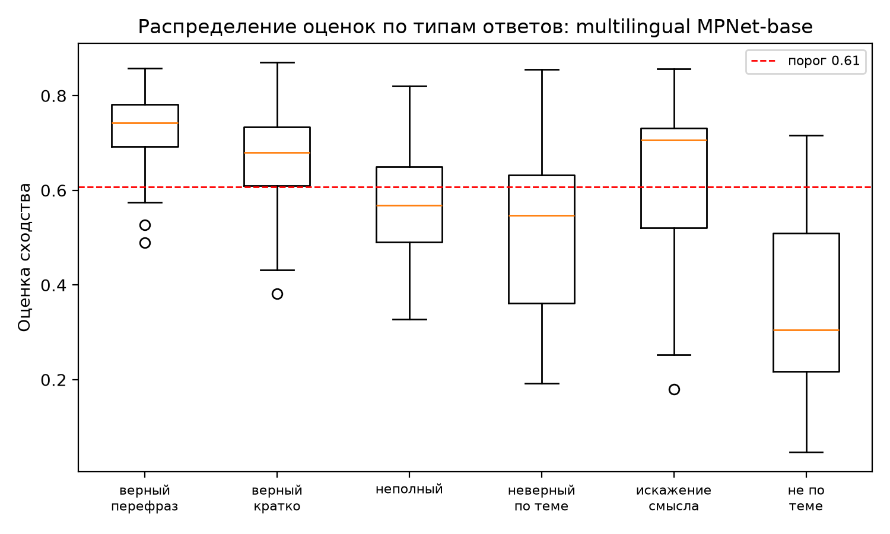
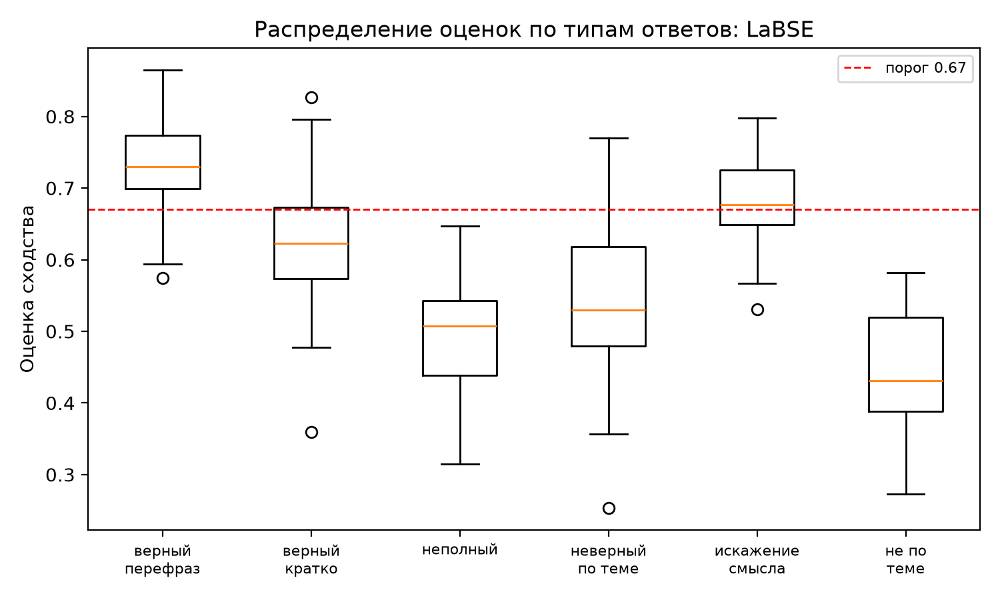
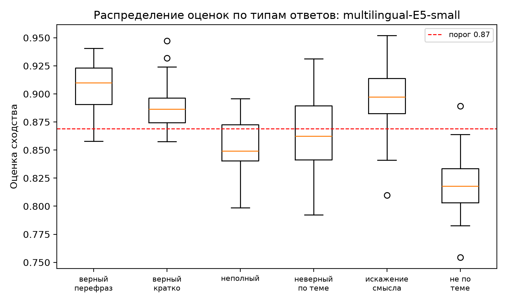
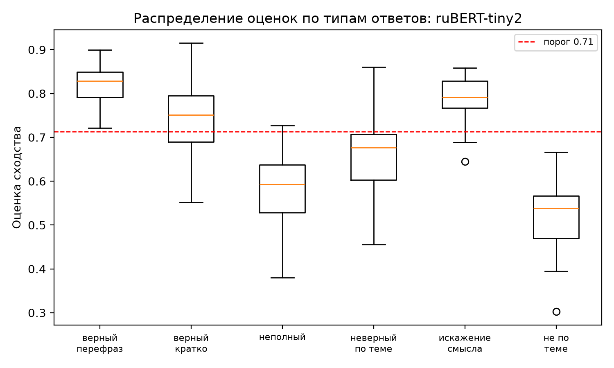
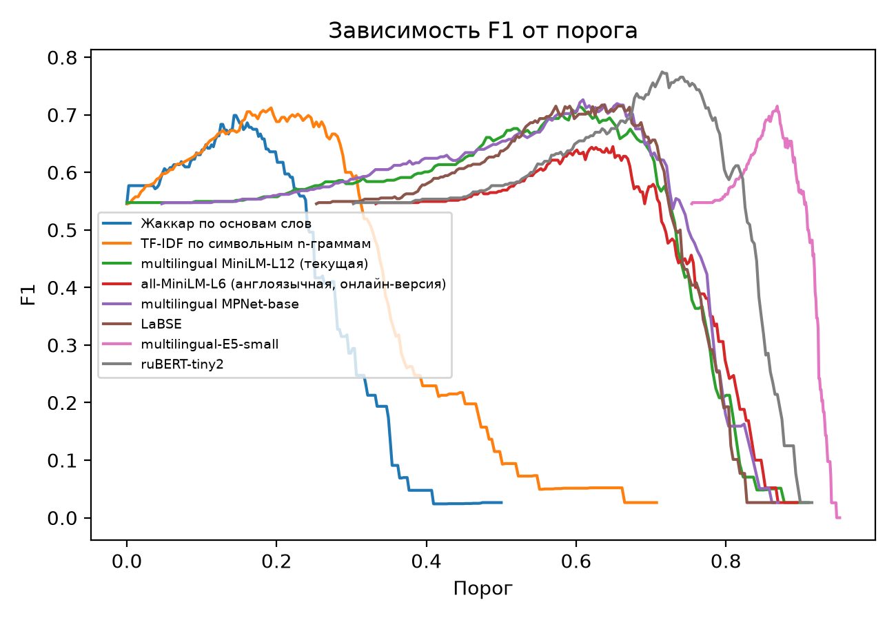

# Результаты эксперимента (02.11.2026 15:49)

Набор: 25 вопросов, 200 ответов (верных 75, неверных 125).

## Сводная таблица

| Метод | ROC-AUC | F1 (CV) | Accuracy (CV) | Порог (CV) | F1 при пороге 0.76 | мс/текст |
|---|---|---|---|---|---|---|
| ruBERT-tiny2 | 0.864 | 0.774 ± 0.071 | 0.800 ± 0.074 | 0.713 ± 0.000 | 0.752 | 0.9 |
| multilingual MPNet-base | 0.823 | 0.730 ± 0.067 | 0.755 ± 0.064 | 0.607 ± 0.000 | 0.477 | 21.6 |
| multilingual MiniLM-L12 (текущая) | 0.790 | 0.703 ± 0.069 | 0.730 ± 0.058 | 0.604 ± 0.003 | 0.364 | 8.2 |
| LaBSE | 0.846 | 0.692 ± 0.051 | 0.750 ± 0.065 | 0.641 ± 0.016 | 0.408 | 21.5 |
| multilingual-E5-small | 0.810 | 0.691 ± 0.024 | 0.695 ± 0.037 | 0.867 ± 0.003 | 0.547 | 7.1 |
| Жаккар по основам слов | 0.764 | 0.682 ± 0.062 | 0.710 ± 0.068 | 0.145 ± 0.004 | 0.000 | — |
| TF-IDF по символьным n-граммам | 0.798 | 0.648 ± 0.108 | 0.695 ± 0.066 | 0.209 ± 0.031 | 0.000 | — |
| all-MiniLM-L6 (англоязычная, онлайн-версия) | 0.741 | 0.607 ± 0.075 | 0.610 ± 0.108 | 0.634 ± 0.020 | 0.400 | 9.3 |

F1 (CV) и Accuracy (CV) — среднее ± ст. отклонение по 5 блокам, разбиение по вопросам: порог подбирался на одних вопросах и проверялся на других.

## Лучший метод

**ruBERT-tiny2**: рекомендуемый порог **0.71** (по всему набору: F1 = 0.775, precision = 0.684, recall = 0.893).

## Доля ответов, засчитанных как верные, по типам ответа (порог — лучший для метода)

| Метод | верный, перефраз | верный, кратко | неполный | неверный по теме | искажение смысла | не по теме |
|---|---|---|---|---|---|---|
| ruBERT-tiny2 | 100% | 68% | 4% | 18% | 84% | 0% |
| multilingual MPNet-base | 94% | 76% | 32% | 28% | 60% | 8% |
| multilingual MiniLM-L12 (текущая) | 92% | 72% | 36% | 28% | 60% | 4% |
| LaBSE | 90% | 28% | 0% | 8% | 52% | 0% |
| multilingual-E5-small | 96% | 84% | 28% | 44% | 76% | 4% |
| Жаккар по основам слов | 86% | 88% | 24% | 34% | 92% | 0% |
| TF-IDF по символьным n-граммам | 86% | 100% | 36% | 30% | 92% | 4% |
| all-MiniLM-L6 (англоязычная, онлайн-версия) | 86% | 84% | 20% | 48% | 88% | 32% |

Для верных типов (первые два столбца) чем выше, тем лучше; для остальных — чем ниже, тем лучше.

## Средняя оценка сходства по типам ответа

| Метод | верный, перефраз | верный, кратко | неполный | неверный по теме | искажение смысла | не по теме |
|---|---|---|---|---|---|---|
| ruBERT-tiny2 | 0.824 | 0.742 | 0.575 | 0.663 | 0.783 | 0.520 |
| multilingual MPNet-base | 0.728 | 0.663 | 0.576 | 0.510 | 0.618 | 0.351 |
| multilingual MiniLM-L12 (текущая) | 0.721 | 0.654 | 0.562 | 0.522 | 0.634 | 0.370 |
| LaBSE | 0.732 | 0.619 | 0.498 | 0.540 | 0.677 | 0.442 |
| multilingual-E5-small | 0.906 | 0.889 | 0.851 | 0.865 | 0.895 | 0.819 |
| Жаккар по основам слов | 0.227 | 0.235 | 0.119 | 0.130 | 0.303 | 0.033 |
| TF-IDF по символьным n-граммам | 0.292 | 0.370 | 0.159 | 0.159 | 0.378 | 0.062 |
| all-MiniLM-L6 (англоязычная, онлайн-версия) | 0.728 | 0.681 | 0.564 | 0.641 | 0.715 | 0.564 |

## Графики

